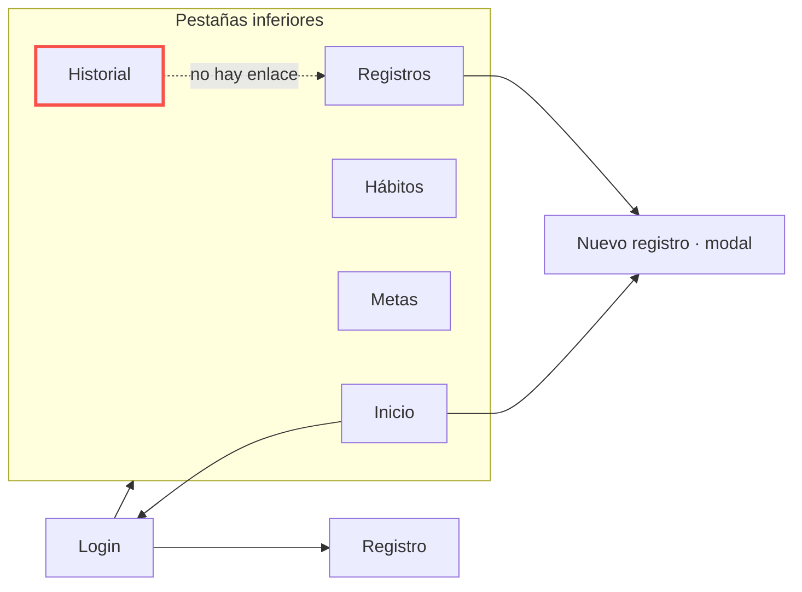

# 01 · Auditoría UX: Registros e Historial

Revisé las dos pantallas que me tocan de Healthy Habits Tracker: **Registros** (`RegistrosScreen`, la lista de registros diarios) e **Historial** (`HistorialScreen`, el cumplimiento por mes y por semana). Las capturas de cómo están hoy son `img/before-registros.png` y `img/before-historial.png`.

| # | Pantalla | Problema | Principio | Severidad | Arreglo propuesto |
| --- | --- | --- | --- | --- | --- |
| 1 | Registros | Mientras llegan los registros no se muestra nada que indique carga; con el backend conectado la lista quedaría vacía unos segundos | Estados de la interfaz | Alta | Filas grises con la forma de un registro |
| 2 | Registros | Si la petición falla no hay mensaje ni forma de volver a pedir los datos | Retroalimentación | Alta | Mensaje de error y botón Reintentar |
| 3 | Registros | Las notas del registro usan `colors.subtle` (#484F58) sobre la tarjeta #161B22: 2,09:1 | Contraste | Alta | Usar un color de texto secundario con 4,5:1 o más |
| 4 | Registros | La unidad debajo del valor (vasos, minutos…) mide 10 px (`fontSize.xs - 1`) | Textos legibles | Media | Mínimo `fontSize.xs` (11 px) |
| 5 | Registros | El botón "+" de nuevo registro mide 40 × 40 px y no tiene `accessibilityLabel` | Área táctil y etiquetas | Media | 48 × 48 px y etiqueta "Nuevo registro" |
| 6 | Registros | El botón de eliminar es solo el carácter "✕" (18 px) con `hitSlop` de 8 px; el área que se puede tocar queda por debajo de 44 px | Área táctil mínima | Media | Contenedor de 44 × 44 px |
| 7 | Registros | Si la meta se cumplió o no se ve por el color verde del valor y por un emoji (✅ / ⭕); no hay texto que lo diga | El color no debe ser la única señal | Media | Texto "Meta cumplida" / "Sin cumplir" o etiqueta accesible |
| 8 | Historial | El porcentaje de cumplimiento cambia a verde, naranja o rojo según el rango, pero la pantalla no explica qué significa cada color | El color no debe ser la única señal | Media | Leyenda o palabra junto al porcentaje (alto, medio, bajo) |
| 9 | Historial | No tiene estados de carga ni de error | Estados de la interfaz | Media | Mismo patrón de estados que Registros |
| 10 | Historial | Desde un hábito con cumplimiento bajo no se puede ir a ver sus registros; hay que cambiar a la pestaña Registros y filtrar a mano | Patrón de navegación | Baja | Tocar el hábito abre Registros ya filtrado |

## Navegación actual

**Dónde se pierde el usuario:** en Historial ve qué hábito va mal, pero no hay camino desde ahí hasta los registros de ese hábito. Tiene que ir a la pestaña Registros, abrir el filtro y buscar el hábito (línea punteada).
