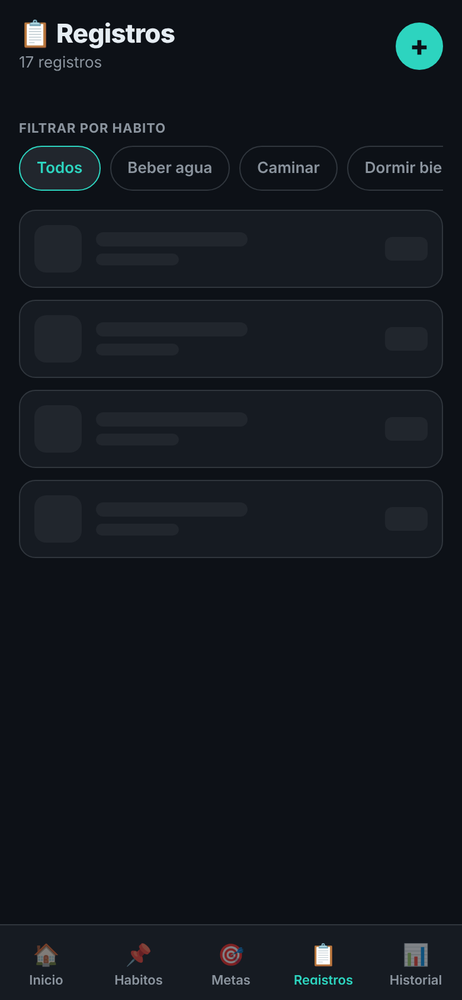
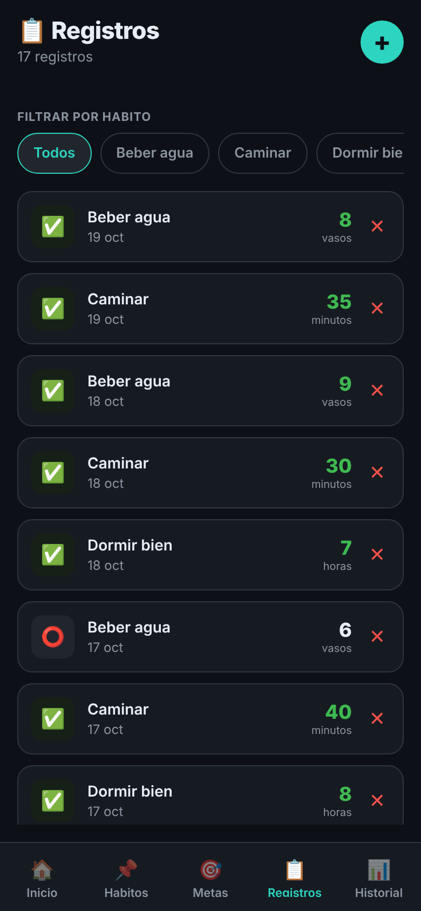
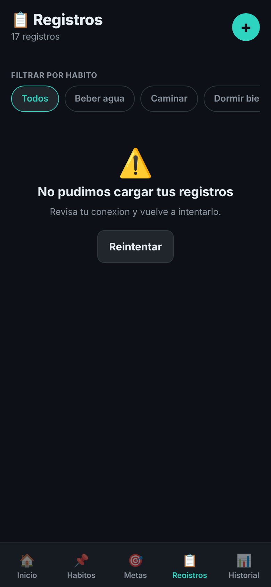
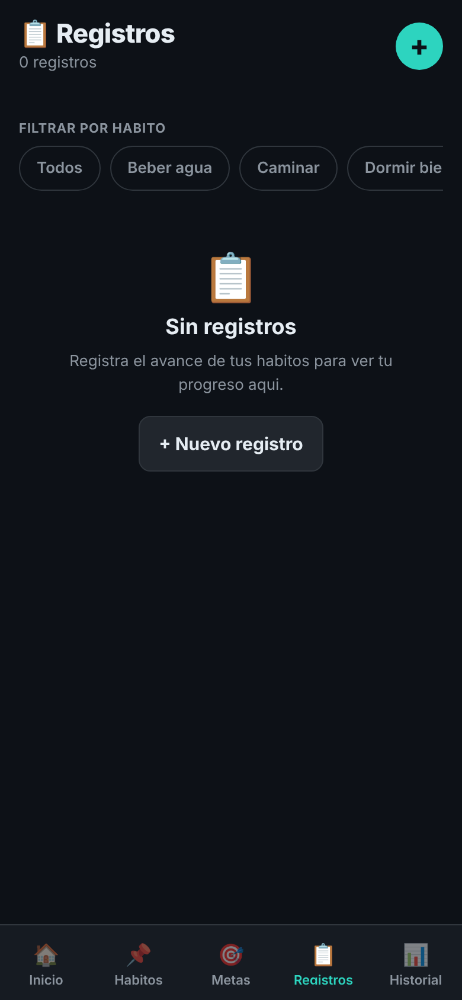

# 03 · Estados de la lista de Registros

`app/src/screens/RegistrosScreen.tsx` muestra ahora un estado distinto según cómo vaya la petición de registros. La lógica de carga está en `app/src/hooks/useCargaRegistros.ts`.

| Estado | Qué aparece | Captura |
| --- | --- | --- |
| Cargando | Cuatro filas grises con la forma de un registro: cuadro del estado, nombre del hábito y fecha, valor a la derecha (`RegistrosCargando`) |  |
| Con datos | Los registros diarios, del más reciente al más antiguo, con el filtro por hábito |  |
| Error | "No pudimos cargar tus registros" y el botón **Reintentar** |  |
| Vacío | "Sin registros" y el botón **+ Nuevo registro** |  |

Deslizando la lista hacia abajo se vuelven a pedir los registros (`RefreshControl`, equivalente a `IonRefresher`).

## Cómo se fuerza cada estado

El endpoint de registros del backend todavía no está conectado, así que `pedirRegistros()` simula la respuesta:

- **Cargando:** aparece al abrir la pestaña (1 segundo). Para verlo más tiempo: `EXPO_PUBLIC_DEMORA_MS=5000 npm start`.
- **Error:** `EXPO_PUBLIC_FALLA_REGISTROS=1 npm start`.
- **Vacío:** elegir **Meditar** en el filtro: es un hábito real de la app que todavía no tiene registros.
- **Con datos:** `npm start` sin variables.

## Prueba

`app/src/screens/__tests__/RegistrosScreen.test.tsx` (Jest + React Native Testing Library, con temporizadores falsos para no esperar el segundo real):

1. Con la falla activada, después de la espera aparece "No pudimos cargar tus registros".
2. Se quita la falla, se toca **Reintentar** y, al terminar la nueva petición, el error desaparece y vuelven a verse los registros ("Beber agua").

```bash
cd app
npm test
```
