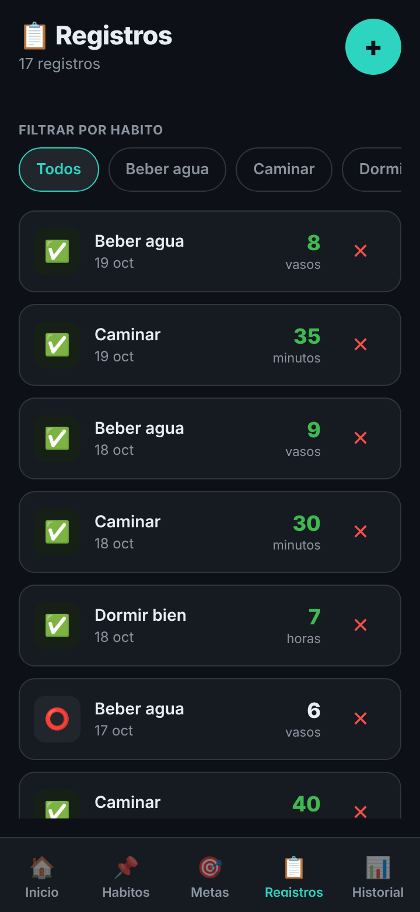
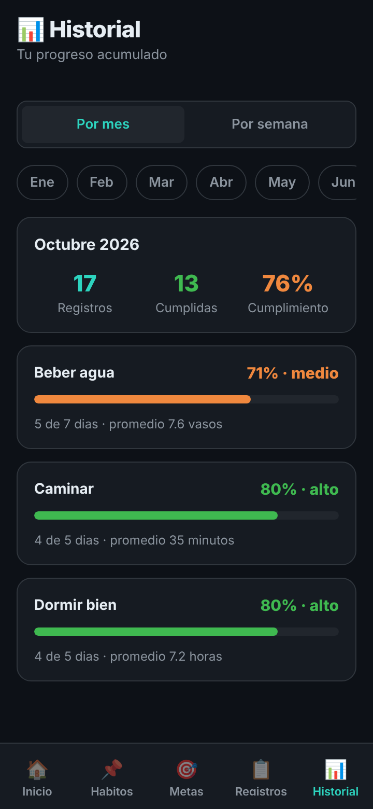
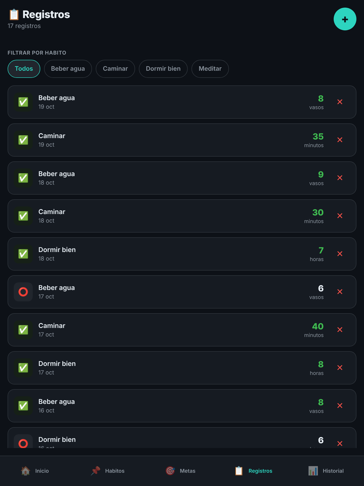
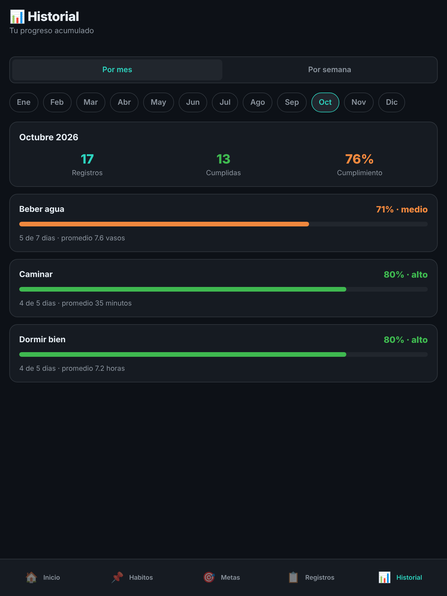

# 04 · Accesibilidad y responsivo en Registros e Historial

## Correcciones

- **Botón "+" de Registros:** medía 40 × 40 px y no tenía etiqueta. Ahora mide 48 × 48 px y el lector de pantalla dice "Nuevo registro".
- **Botón ✕ para eliminar un registro:** era un carácter suelto con `hitSlop`. Ahora tiene un área mínima de 44 × 44 px y rol de botón.
- **Meta cumplida o no:** antes solo se sabía por el color del valor y un emoji. El cuadro del estado ahora se anuncia como "Meta cumplida" o "Meta sin cumplir".
- **Unidad del registro:** pasó de 10 px a 11 px (`fontSize.xs`).
- **Filtro por hábito de Registros:** cada chip se anunciaba como `radio` pero sin `aria-checked`, así que el lector de pantalla no decía cuál estaba elegido (Lighthouse lo marcó). `ChipSelector` ahora usa `aria-checked`.
- **Selector Por mes / Por semana de Historial:** las dos opciones tenían rol `tab` sin un contenedor `tablist` (Lighthouse lo marcó). El contenedor de `SegmentedTabs` ahora tiene `accessibilityRole="tablist"`.
- **Porcentaje en Historial:** el verde, naranja o rojo ya no es la única señal; junto al porcentaje aparece el nivel en palabras: alto (80 % o más), medio (50 % a 79 %) o bajo.

Los textos de React Native crecen con el tamaño de letra del sistema porque `allowFontScaling` está activo por defecto, así que no hizo falta cambiar tamaños fijos por esa razón.

## Puntajes de Lighthouse (Accesibilidad)

Con la app en el navegador (`npm run web`) y Lighthouse en modo **Instantánea** sobre cada pestaña (en modo Navegación solo se evalúa el Login):

| Pantalla | Antes | Después | Qué faltaba |
| --- | --- | --- | --- |
| Registros | 94 | 100 | `aria-checked` en los chips del filtro |
| Historial | 94 | 100 | contenedor `tablist` para Por mes / Por semana |

## Capturas a 360 px y 768 px

| | Registros | Historial |
| --- | --- | --- |
| 360 px |  |  |
| 768 px |  |  |

Qué se vio en cada ancho:

- **360 px:** las filas de Registros caben con el valor y el ✕ a la derecha; los chips del filtro no caben todos y se desplazan de lado, que es lo esperado. En Historial los meses también se desplazan de lado y las tarjetas de porcentaje se leen completas.
- **768 px:** aparecen todos los chips y los doce meses sin desplazamiento. Nada se rompe; las filas se estiran a todo el ancho.
