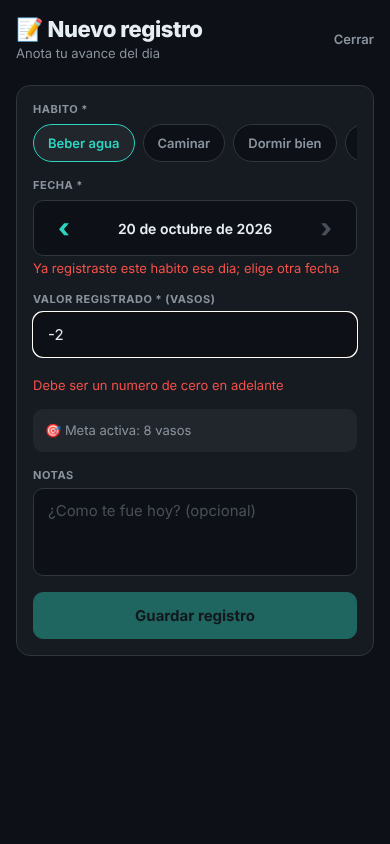
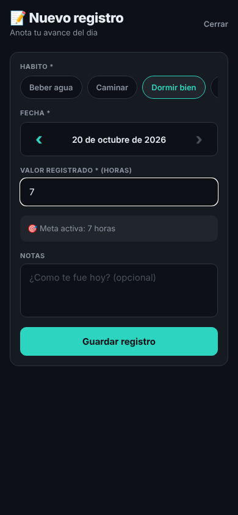
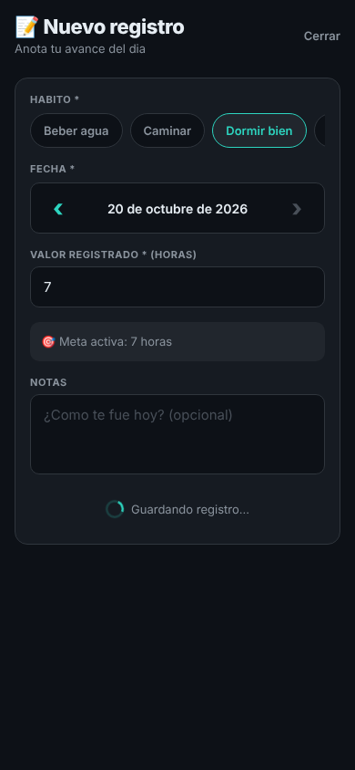
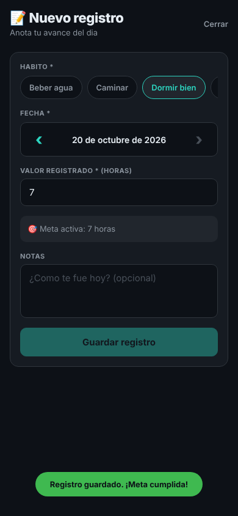
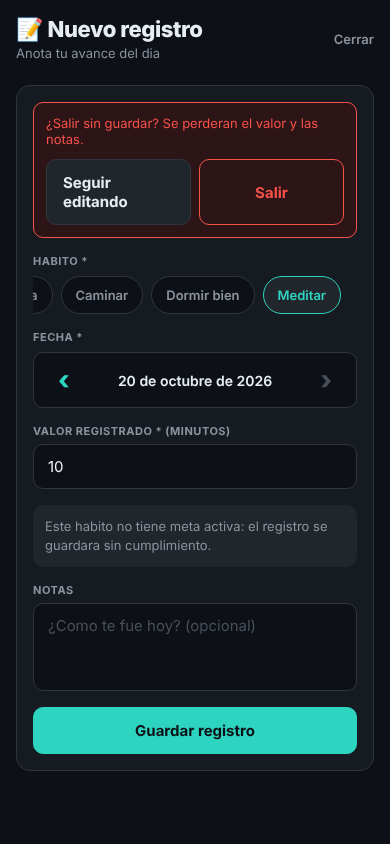
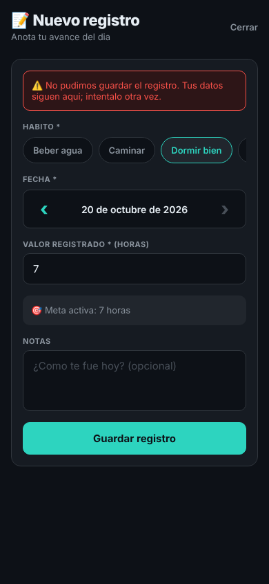

# 06 · Formulario de Nuevo registro

El formulario que más se usa en Healthy Habits Tracker es **Nuevo registro** (`app/src/screens/NuevoRegistroScreen.tsx`): ahí el usuario anota cada día cuánto cumplió de un hábito, y de esos `RegistroDiario` salen la lista de Registros, la racha y el Historial. Se abre desde el "+" de Registros o desde Inicio.

La lógica del formulario quedó en `app/src/hooks/useFormularioRegistro.ts`; la pantalla solo pinta los campos y los mensajes.

## Validaciones

**Hábito (obligatorio).** `RegistroDiario.habitoId` no puede faltar: un registro siempre pertenece a un hábito. Si el usuario escribe un valor sin elegir hábito, debajo de los chips aparece "Elige el habito que vas a registrar".

**Fecha (obligatoria, no futura, sin repetir).** El registro es del día en que se hizo el hábito, así que no se aceptan días que todavía no llegan (la flecha › ya se bloqueaba en hoy). Además la app ya tenía la regla "un único registro por hábito y fecha" en `crearRegistro` del `AppContext`, que copia la del backend; antes solo se veía al tocar Guardar, y ahora se avisa debajo de la fecha en cuanto se elige: "Ya registraste este habito ese dia; elige otra fecha".

**Valor registrado (obligatorio, número ≥ 0).** `valorRegistrado` es un número en la unidad del hábito (vasos, minutos, horas) y se compara con `Meta.valorObjetivo` para saber si la meta se cumplió. Un valor negativo o con letras rompería esa comparación. Mensajes: "Escribe cuanto hiciste" y "Debe ser un numero de cero en adelante".

**Notas (opcional).** En el modelo es `notas?`, así que no tiene validación.

## Retroalimentación

- "Guardar registro" queda deshabilitado mientras haya un error.
- Al guardar, el botón se cambia por un indicador de carga con "Guardando registro…"; mientras tanto no se puede volver a enviar.
- Si sale bien, aparece abajo un aviso verde (`AvisoFlotante`, que hace de `IonToast`) con el mensaje que ya devolvía la app ("Registro guardado. ¡Meta cumplida!" o "Sigue esforzandote") y la pantalla se cierra.
- Si el servidor falla, arriba aparece "No pudimos guardar el registro…" y lo escrito no se borra.
- Si el usuario toca **Cerrar** con un valor o notas escritos, la app pregunta "¿Salir sin guardar?" con **Seguir editando** y **Salir**, en lugar de botar los datos. Es el reemplazo de `IonAlert`: la app es React Native y `Alert.alert` no aparece en el navegador.

## Para probar cada caso

El endpoint de registros no está conectado, así que el envío se simula dentro del hook:

- Error por campo: elegir **Beber agua** en la fecha de hoy (ya tiene registro) y escribir `-2`.
- Guardando: `EXPO_PUBLIC_DEMORA_MS=3000 npm run web`.
- Falla del servidor: `EXPO_PUBLIC_FALLA_GUARDAR_REGISTRO=1 npm run web`.
- Éxito: **Dormir bien**, hoy, valor 7.
- Confirmar salida: escribir un valor y tocar **Cerrar**.

## Capturas

| Con errores | Listo para guardar | Guardando |
| --- | --- | --- |
|  |  |  |

| Guardado (toast) | ¿Salir sin guardar? | Falla del servidor |
| --- | --- | --- |
|  |  |  |
