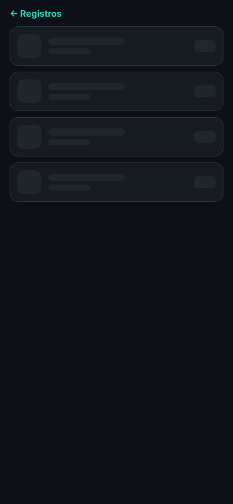
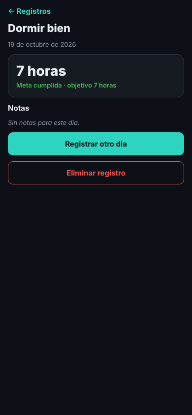
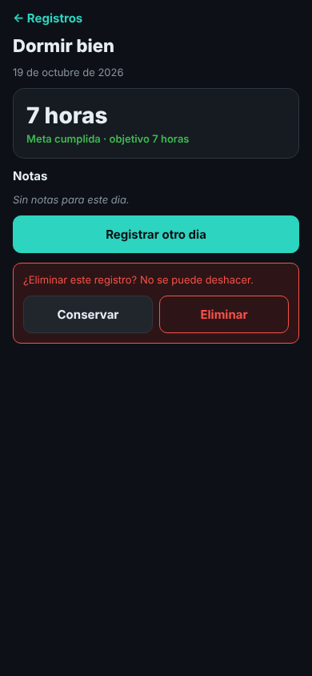
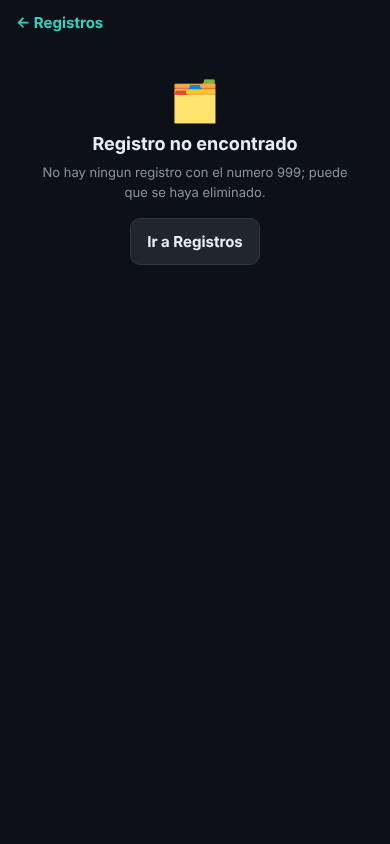
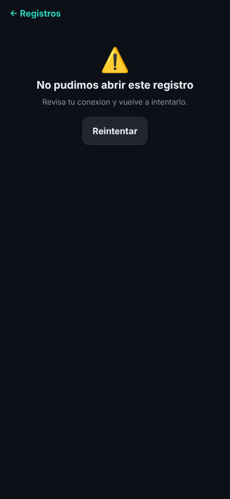
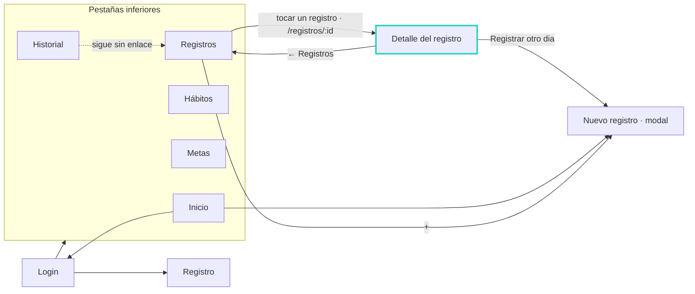

# 07 · Detalle de un registro y flujo completo

## Qué se agregó

En la lista de Registros, tocar el nombre del hábito (o la fecha) abre **RegistroDetalleScreen** (`app/src/screens/RegistroDetalleScreen.tsx`). La pantalla recibe el `id` del `RegistroDiario`:

- dentro de la pila, como parámetro: `RegistroDetalle: { id: number }` en `types/index.ts`;
- en el navegador, en la URL: `/registros/:id`, definido en `app/src/navigation/enlaces.ts`. Por ejemplo, el registro de Dormir bien de ayer queda en `/registros/5`.

El detalle muestra el hábito, la fecha completa, el valor con su unidad, si la meta se cumplió y contra qué objetivo, y las notas. Tiene dos acciones: **Registrar otro dia**, que abre Nuevo registro con el mismo hábito ya elegido, y **Eliminar registro**, que pide confirmación ("¿Eliminar este registro? No se puede deshacer.") con Conservar / Eliminar. En la lista, el ✕ usa `Alert.alert`, que en el navegador no muestra nada; desde el detalle sí se puede borrar con confirmación en web.

**← Registros** (mínimo 44 × 44 px) regresa a la lista. Si se entró pegando la URL y no hay pantalla anterior, va a las pestañas.

La carga reutiliza el hook `useCargaRegistros` del CP3 con su propia petición simulada:

| Estado | Pantalla | Para verlo |
| --- | --- | --- |
| Cargando | Filas grises (`RegistrosCargando`) | Al abrir; `EXPO_PUBLIC_DEMORA_MS=4000` para que dure más |
| Con datos | Registro completo | Tocar cualquier registro |
| Error | "No pudimos abrir este registro" y Reintentar | `EXPO_PUBLIC_FALLA_DETALLE_REGISTRO=1 npm run web` |
| No encontrado | "Registro no encontrado" e Ir a Registros | Abrir `/registros/999` |

La prueba `app/src/screens/__tests__/RegistroDetalleScreen.test.tsx` comprueba que se muestra el registro del id recibido y el aviso cuando el id no existe.

| Cargando | Con datos | Confirmar eliminación |
| --- | --- | --- |
|  |  |  |

| No encontrado | Error |
| --- | --- |
|  |  |

## Mapa nuevo

El patrón del CP2 no cambia: pestañas para las cinco secciones y pila para lo que se abre encima.

## Frente al mapa del CP1

- **Volver a registrar un hábito que ya se venía anotando:** antes era "+" → buscar el hábito entre los chips → valor → Guardar. Desde el detalle es Registrar otro dia → valor → Guardar; el paso de buscar el hábito desaparece.
- **Saber contra qué meta se comparó un día:** antes la lista solo mostraba ✅ o ⭕, y el objetivo había que buscarlo en la pestaña Metas (cambiar de pestaña y encontrar el hábito). Ahora está en el detalle, con un toque.
- **Borrar un registro desde el navegador:** antes no se podía (el ✕ no responde en web). Ahora son dos toques con confirmación.
- La línea punteada de Historial a Registros, el problema que marqué en el CP1, sigue pendiente; queda para las historias del CP9.
